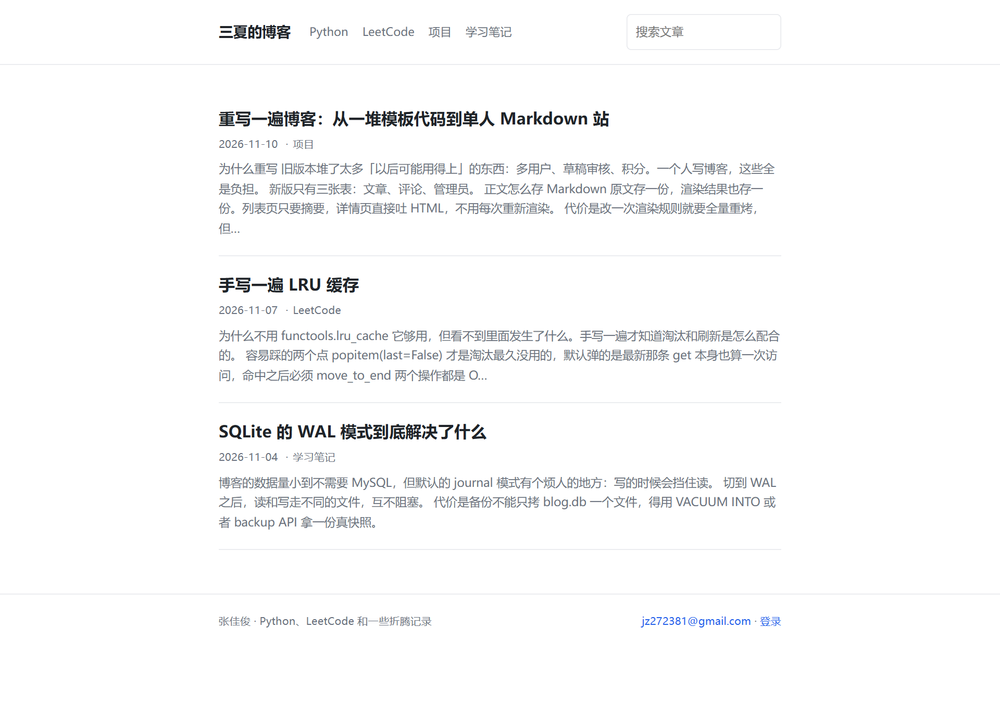
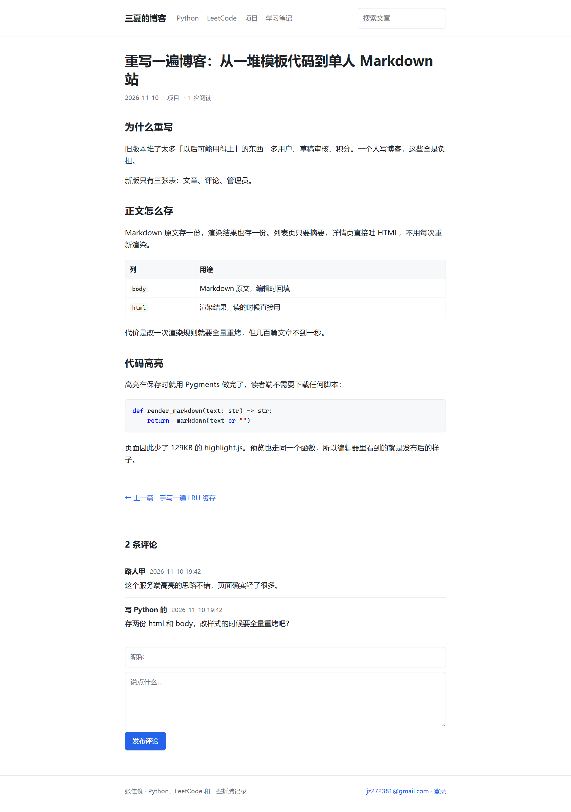
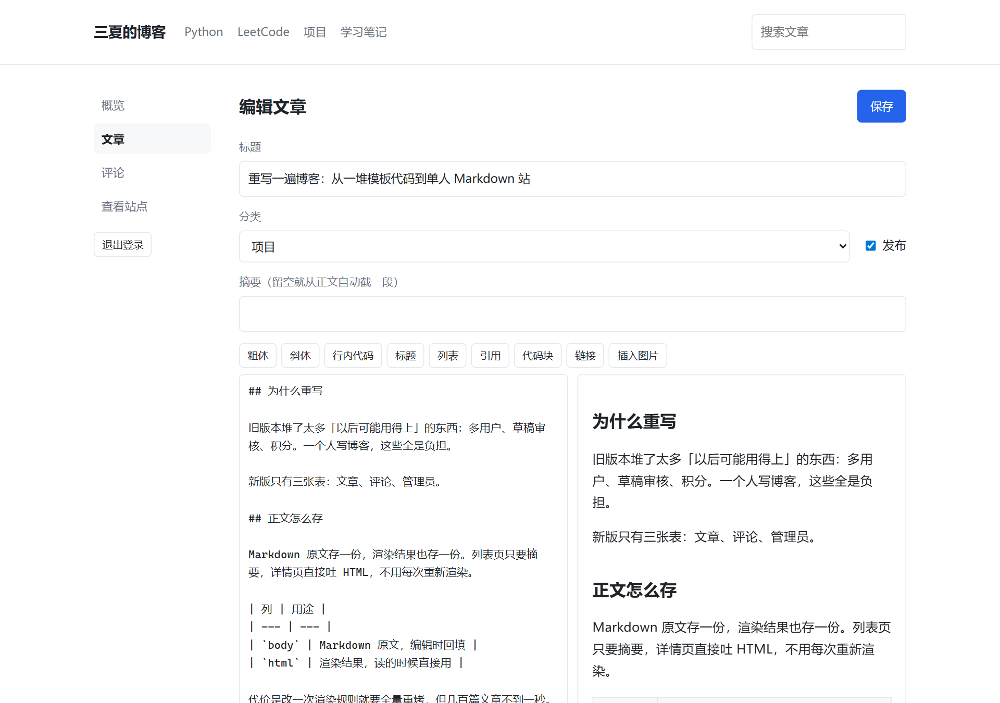
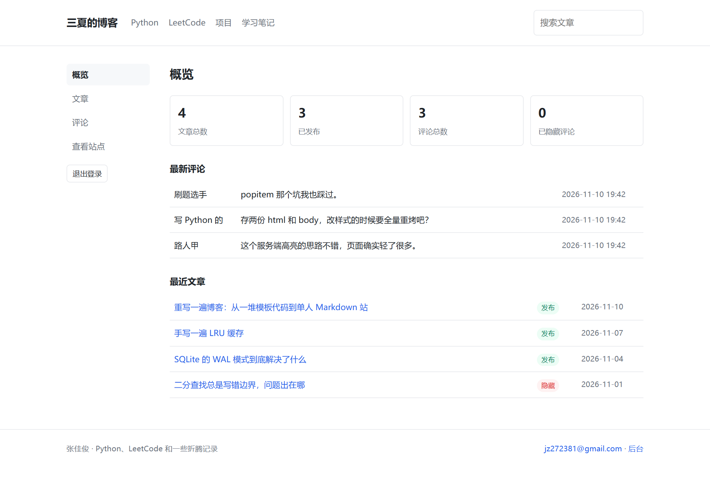

# pythonBlog

一个人的博客：Markdown 写作，访客留个昵称就能评论，SQLite 存数据。Flask + 原生 JS，没有前端构建。

| 首页 | 文章页 |
| --- | --- |
|  |  |

| 编辑器（预览由服务端渲染） | 后台 |
| --- | --- |
|  |  |

## 功能

- 首页列表、分类浏览、标题/正文搜索、分页
- Markdown 文章页，代码块在保存时用 Pygments 高亮成静态 HTML —— 读者端不加载任何高亮脚本
- 访客填昵称即可评论，限流 5 次/分钟；后台可隐藏或删除
- 后台写作：实时预览（和保存后完全一致）、插图上传、Ctrl+S 保存、本地草稿
- 密码 scrypt 哈希，全站 CSRF，安全响应头

## 启动

需要 Python 3.11+ 和 [uv](https://docs.astral.sh/uv/)。

```powershell
uv sync
uv run flask --app app create-admin      # 第一次：建管理员
uv run flask --app app run --debug
```

打开 <http://127.0.0.1:5000>，后台在 `/admin`。数据库自动建在 `instance/blog.db`；`SECRET_KEY` 不配也行，首次启动会生成并存在 `instance/secret_key`，`.env` 里只有 `DEBUG_MODE` 需要关心。

不想用 `uv run` 也可以跑脚本：`.\scripts\start.ps1`（`-Mode prod` 换 waitress 常驻）。

## 日常

- **写文章**：后台 → 文章 → 写文章。正文是 Markdown，Ctrl+S 保存；新写的文章没保存就关掉页面，正文会留在浏览器里，下次打开接着写。
- **配图**：点「插入图片」，图片自动压到 1600px 宽、重新编码成 JPEG（顺手抹掉 EXIF）再存。
- **改站点信息**：`config.py` 里的站名、简介、分类、邮箱。
- **忘了密码**：重跑 `uv run flask --app app create-admin`，输入同名账号就是重置。
- **备份**：`.\scripts\backup.ps1`，把数据库和图片按时间戳拷到 `%USERPROFILE%\blog-backup`。
- **改了表结构**：删掉 `instance/blog.db` 重新建（单人博客，没有迁移机制）。

## 结构

```text
app.py         应用工厂、安全响应头、错误页、CLI
config.py      站名、分类、分页、长度限制
models.py      文章、评论、管理员三张表
utils.py       Markdown 渲染（含代码高亮）、密码哈希、图片处理、日志
routes/        blog.py 访客侧，admin.py 后台
templates/     Jinja 模板
static/        CSS、两个小 JS、favicon、上传的图片
tests/         pytest
scripts/       启动、备份、本地检查
```

## 检查

没有 CI，检查都在本地跑：

```powershell
.\scripts\check.ps1        # ruff check + ruff format --check + pytest
```

WSL 里跑同样三条：`uv run ruff check . && uv run ruff format --check . && uv run pytest`。
